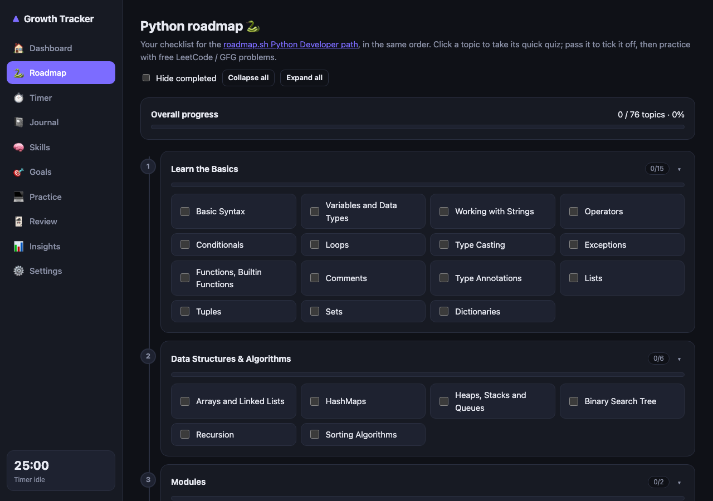
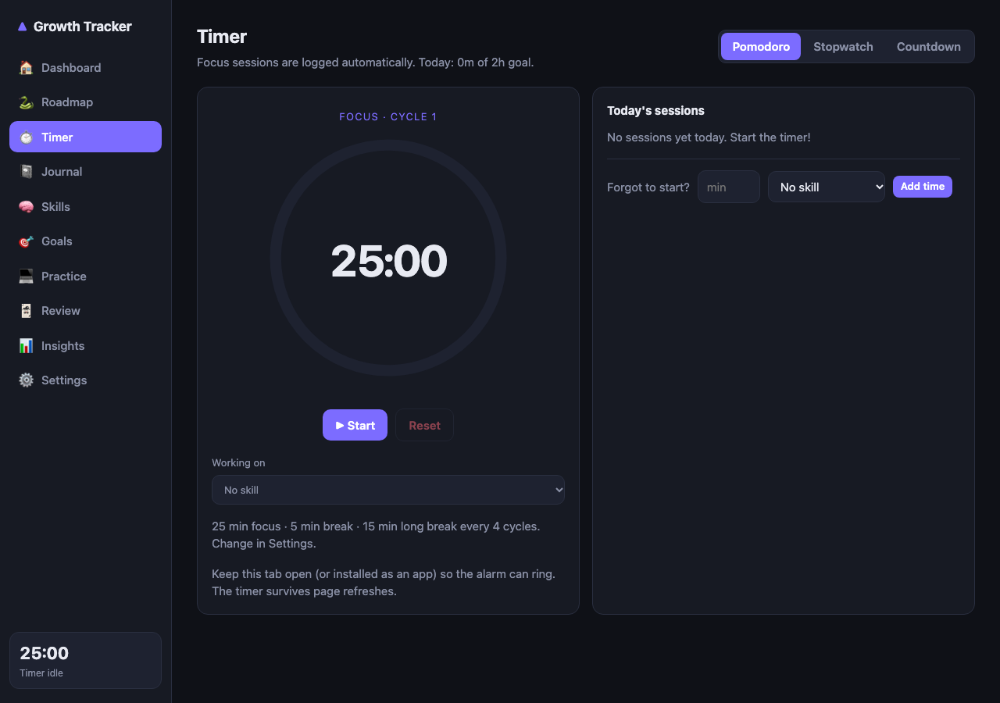

# Growth Tracker

An offline-first web app to track your growth as a developer. Focus timers with alarms, a daily journal, a skills map, a **Python roadmap checklist where every topic is unlocked by passing a quick quiz**, and spaced-repetition flashcards.

**No backend. No accounts. No API keys.** Everything is stored in your browser (IndexedDB) and never leaves your device.

**Live demo: https://growth-tracker-ecru.vercel.app**

| Python roadmap (quiz-gated checklist) | Focus timer |
|---|---|
|  |  |

## Features

| Area | What you get |
|---|---|
| **Timers & alarms** | Pomodoro, stopwatch and countdown; sessions auto-logged per skill; sound + desktop notifications; survives page refresh |
| **Python roadmap** | Checklist following the [roadmap.sh Python path](https://roadmap.sh/python). Click a topic → answer a 2-question quiz (concept + read-the-code). Pass to tick it, then open free LeetCode / GeeksforGeeks practice in a popup |
| **Journal** | Learned / blockers / wins, mood & energy, tags, search, code fences, voice dictation |
| **Skills** | Skill tree with levels, radar chart, "last practiced" tracking |
| **Goals** | Quarterly goals with weekly milestones |
| **Practice log** | Problems (with retry dates), projects & PRs, reading & videos |
| **Review** | SM-2 spaced-repetition flashcards and a problem-retry queue |
| **Dashboard & insights** | Heatmap, streaks, daily goal, weekly/monthly charts, best focus time, rule-based nudges |
| **Data ownership** | JSON export / import backup |
| **PWA** | Installable, works offline |

## Getting started

Requires Node.js 20+.

```bash
git clone <your-fork-url>
cd growth-tracker
npm install
npm run dev        # http://localhost:5173
```

Other scripts:

```bash
npm test           # unit tests + quiz-data integrity checks
npm run build      # type-check + production build into dist/
npm run preview    # serve the production build (service worker / install work here)
```

## Deploy to Vercel

Import the repo in Vercel. The Vite preset is auto-detected (`npm run build`, output `dist`) and `vercel.json` is included. The app uses hash routing, so no rewrite rules are needed.

## Privacy

- All data is stored locally in your browser. There is no server and no analytics.
- **Voice dictation** uses the browser's built-in Web Speech API. In Chrome and Edge, audio is processed by the browser vendor's speech service (not by this app). It is unsupported in Firefox. Dictation is optional and only starts when you click the mic button.
- Practice buttons simply open LeetCode / GeeksforGeeks / Google search in a new window. No data is sent to them by this app.
- Browser data can be cleared by you or your browser, so use **Settings → Export backup** regularly.

## Limitations

- Alarms and reminders fire while the app is open in a tab or installed as an app. Browsers can't wake a closed page without a server.
- The quiz bank is small and static (2 questions per topic). Contributions welcome, see below.

## Contributing

See [CONTRIBUTING.md](CONTRIBUTING.md). Adding or improving quiz questions is the easiest way to help.

## Credits & disclaimer

The roadmap topics follow the Python Developer roadmap at [roadmap.sh](https://roadmap.sh/python). This project is an **unofficial** companion and is **not affiliated with or endorsed by roadmap.sh, LeetCode or GeeksforGeeks**. Their names belong to their respective owners. Please consult roadmap.sh for the original roadmap and its license terms.

## License

[MIT](LICENSE)
