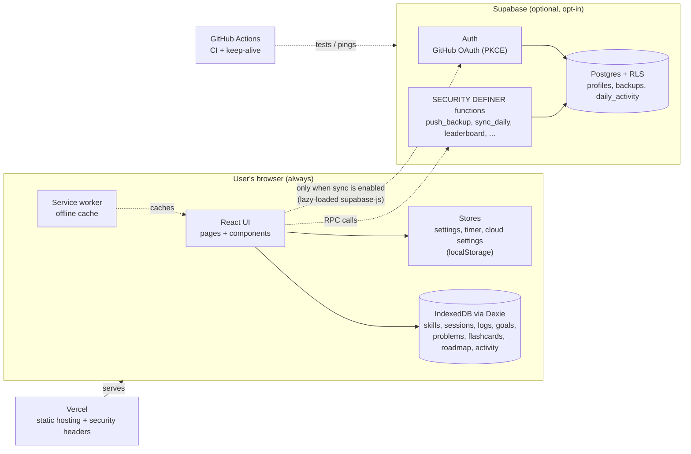
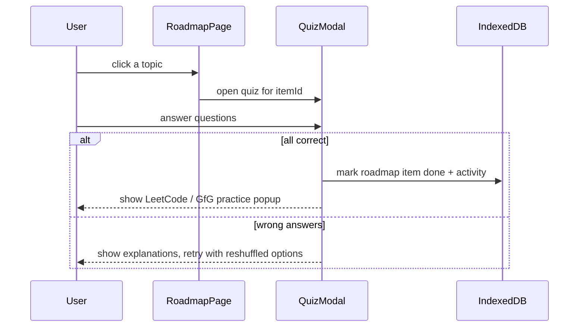
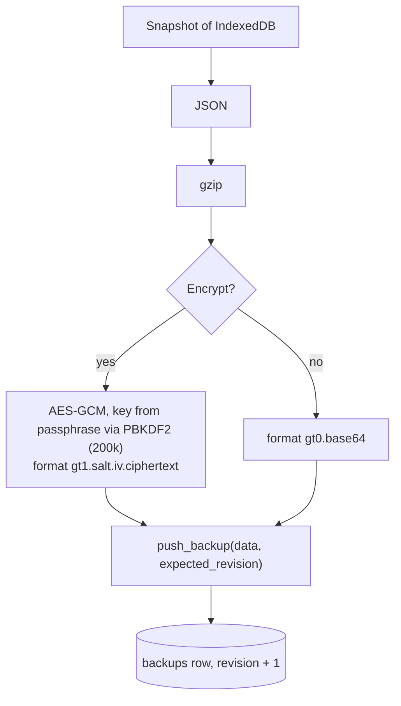
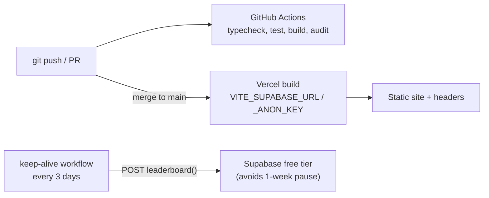

# Architecture

Growth Tracker is a **local-first single-page app**. The browser is the source of truth; the cloud is an
optional, opt-in add-on. This document describes the system as it is today (v1.0).

## 1. System overview



Key properties:

- **No backend of our own.** Hosting is static files; the only server-side logic is SQL inside Supabase.
- **Off by default.** With cloud sync disabled the app makes no network calls and `supabase-js` is never downloaded.
- **Hash routing** (`/#/roadmap`), so any static host works without rewrite rules.

## 2. Frontend

| Layer | Location | Responsibility |
|---|---|---|
| Entry | `src/main.tsx`, `src/App.tsx` | Mounts the router, error boundary, global hooks (timer loop, auto-sync, theme) |
| Routes | `src/routes.tsx` | Single list that drives the router, sidebar and mobile nav; pages are lazy-loaded |
| Pages | `src/pages/*` | One file per screen (Dashboard, Roadmap, Timer, Journal, Skills, Goals, Practice, Review, Insights, Leaderboard, Settings) |
| Components | `src/components/*` | Shared UI (`ui.tsx`), `Sidebar`, `QuizModal`, `CloudPanel`, `ErrorBoundary` |
| Data layer | `src/db.ts` | Dexie schema (versions 1 to 3), typed `exportAll` / validated `importAll` / `clearAll` |
| Static content | `src/data/*` | Python roadmap, quiz bank and practice links (checked by tests) |
| Domain logic | `src/lib/*` | Timer state machine, SM-2 scheduling, insights, streaks, speech dictation, alarms |
| Persisted stores | `src/lib/storage.ts` | `createStore()` over localStorage with safe reads/writes; used by settings and cloud settings |
| Cloud client | `src/lib/cloud/*` | Everything that talks to Supabase (see section 4) |

Data lives in two places on purpose: **IndexedDB** for records (queryable, large) and **localStorage** for
small preferences and the running timer. Nothing is sent anywhere unless cloud sync is on.

### Quiz-gated roadmap



## 3. Data model

**Browser (IndexedDB)**

| Table | Purpose |
|---|---|
| `skills`, `sessions` | Skill tree and logged focus time |
| `logs` | Journal entries (learned, blockers, wins, mood, energy, tags) |
| `goals`, `milestones` | Quarterly goals and weekly milestones |
| `problems`, `projects`, `resources` | Practice log |
| `flashcards` | SM-2 spaced repetition cards |
| `roadmap` | Which roadmap topics have been passed |
| `activity` | Per-day counters (cards reviewed) used for the leaderboard |

**Cloud (Postgres, row-level security on every table)**

| Table | Contents | Who can read |
|---|---|---|
| `profiles` | Display name, emoji, country, `leaderboard` opt-in flag | Owner (leaderboard exposes name/emoji only for opted-in users, via a function) |
| `backups` | One row per user: the (optionally encrypted) snapshot, revision, size, plus the previous version | Owner only |
| `daily_activity` | Per-day totals: focus minutes, topics passed, problems, cards (no text content) | Owner; aggregated through `leaderboard()` |

## 4. Cloud sync design



**Deciding what to do** (`src/lib/cloud/decide.ts`): compare the cloud revision and the local content hash with
what this device last synced.

| Local changed? | Cloud changed? | Action |
|---|---|---|
| no | no | nothing |
| yes | no | push |
| no | yes | pull |
| yes | yes | **conflict**: the user chooses; a local backup file is downloaded first |

Safety nets:

- **Optimistic concurrency:** `push_backup` takes the revision the client last saw and rejects stale writes.
- **Rate limit** per user, enforced in SQL.
- **Previous version:** the cloud keeps the largest version from the last 7 days; *Restore previous cloud version* swaps it back.
- **Account switch guard:** `lastUserId` stops one account's data being merged into another's on a shared device.
- The encryption passphrase lives only in `sessionStorage`; losing it means the backup cannot be read.

### Leaderboard

Opt-in. The client sends only daily totals through `sync_daily`, which clamps every value. Score per day:
`topics x 10 + focus hours x 2 (max 8 h) + problems x 3 (max 10) + cards x 0.2 (max 50)`, plus a small
active-day bonus; windows are 7 days, 30 days and all time. Turning the leaderboard off deletes the daily rows.

## 5. Security model

| Threat | Control |
|---|---|
| Reading or writing someone else's data | RLS: `select` on own rows only; **no** direct insert/update/delete grants on tables |
| Bypassing validation | All writes go through `SECURITY DEFINER` functions with `search_path` pinned; execute is revoked from `public`, `anon` and `authenticated` and granted back one by one (only `leaderboard` is callable by guests) |
| Spam sign-ups | Trigger `block_email_signups` on `auth.users`; GitHub only |
| Leaked secrets | Only the public anon key is in the bundle; the `service_role` key is never used |
| XSS / injection | React escapes all output; no `dangerouslySetInnerHTML`; strict CSP with no inline scripts; user links must be `http(s)` (`safeHttpUrl`) |
| Clickjacking, MIME sniffing, downgrade | `frame-ancestors 'none'` + `X-Frame-Options`, `nosniff`, HSTS (all in `vercel.json`) |
| Malicious or corrupt backup file | `importAll` validates structure before it deletes anything |
| Open redirects after login | Return route must match an in-app hash route |
| Stale or poisoned offline cache | Service worker caches only successful same-origin responses; cache version bump purges old ones |
| Supply chain | Dependabot, `npm audit` in CI, lockfile, least-privilege workflow permissions |

Report vulnerabilities privately: see [SECURITY.md](../SECURITY.md).

## 6. Testing strategy

| Layer | Tool | What it proves |
|---|---|---|
| Pure logic | Vitest | Streaks, SM-2, formatting, sync decisions, crypto round-trip, URL and storage safety |
| Data | `fake-indexeddb` | Backup export/import round-trip and validation |
| Database rules | **PGlite** (real Postgres in memory) loading `supabase/schema.sql` | RLS, grants, clamping, conflicts, scoring, email block, restore, deletion |
| Sync engine | Vitest + PGlite | The real engine against the real schema |
| Content | Vitest | Every roadmap topic has valid quizzes and practice links |
| Live database | `supabase/smoke-test.sql` | Same checks on a deployed project, always rolled back |

## 7. Build, deploy and operations



- **Bundles:** the initial chunk is small; charts, the roadmap data and the Supabase client load on demand.
- **Environments:** build-time variables choose the Supabase project; there is no in-app connection setting, so the hosted site always talks to the project it was built for.
- **Free-tier caveats:** Supabase pauses inactive projects after a week and has no automatic backups on the free plan.
  Add the repository secrets `SUPABASE_URL` and `SUPABASE_ANON_KEY` so the keep-alive workflow can run.

## 8. Repository layout

```text
.
├── .github/              CI, keep-alive, Dependabot, issue + PR templates
├── docs/                 ARCHITECTURE.md, SYNC.md (setup), PRIVACY.md, screenshots
├── public/               manifest, icons, service worker
├── src/
│   ├── components/       Sidebar, CloudPanel, QuizModal, ErrorBoundary, ui
│   ├── data/             roadmap, quizzes, practice links (+ tests)
│   ├── lib/
│   │   ├── cloud/        auth, client, crypto, backup, decide, engine, autosync, status, stats
│   │   └── *.ts          timer, storage, settings, insights, speech, alarm, util, demo
│   ├── pages/            one file per route
│   ├── db.ts             Dexie schema + export/import
│   ├── routes.tsx        route table (router + nav)
│   └── styles.css        theme tokens and styles
├── supabase/             schema.sql, schema tests, live smoke test
├── SECURITY.md  CONTRIBUTING.md  LICENSE  vercel.json
└── vite.config.ts  tsconfig.json  package.json
```

## 9. Known limits and next steps

- Google and email sign-in are intentionally off (Google needs a Cloud Console setup; email needs a custom SMTP sender).
- Reminders only fire while the app is open; a closed browser cannot be woken without a server.
- Dexie conflicts resolve at whole-backup level (not per record), which keeps the logic simple and predictable.
- The quiz bank is small (2 questions per topic) and Python-only.
